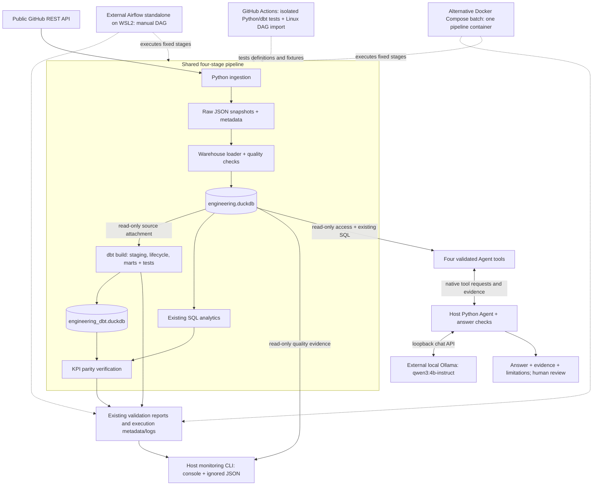

# Agentic Engineering Data Platform

A local Data Engineering and AI Engineering portfolio: turn GitHub pull-request
snapshots into validated analytical data, then let a local AI assistant query it
through restricted, read-only tools.

**Python · SQL · DuckDB · dbt Core · Apache Airflow · Docker Compose · GitHub Actions · Ollama**

[Run the isolated offline demo](docs/demo.md) ·
[Inspect engineering evidence](docs/engineering_evidence.md) ·
[Explore the architecture](docs/architecture.md)

## Problem and solution

Engineering managers need to understand delivery flow and investigate aging work.
PR counts alone omit when observations were collected, what data is missing, and
whether the metrics passed validation. An AI explanation is also unsafe to trust
just because it sounds plausible.

This project preserves source provenance, validates PR lifecycle data, calculates
repository metrics in SQL/dbt, and exposes evidence through a local tool-calling
Agent. Airflow or a Docker batch runtime executes the same four pipeline stages;
CI tests the contracts, and a small monitor inspects existing execution and
quality evidence. The value is traceable metrics and visible uncertainty, rather
than unqualified productivity scores or automated management decisions.

## What is implemented

| Capability | Engineering decisions |
| --- | --- |
| GitHub ingestion | Multiple public repositories; REST pagination links; default cap of 3 pages × 30 PRs per repository; UTC extraction metadata, timeouts, rate-limit handling, and preserved partial results |
| DuckDB warehouse | Raw JSON retained; typed `ingestion_runs` and `pull_requests`; composite PR keys, content-hash run IDs, transactional loading, and rerun-safe upserts |
| Data quality | Required fields, duplicate identifiers, timestamps, and lifecycle consistency; rejected-record reasons and source errors remain visible |
| SQL and dbt analytics | Five documented staging/lifecycle/mart models; read-only source attachment; separate transformed database; 52 dbt data tests; independent KPI parity check against existing SQL |
| Local execution | Airflow 3.3.2 manual DAG with success-only dependencies, timeouts, and serial execution; alternative non-root Docker Compose batch runtime with explicit persistent storage |
| CI and observability | Separate Ubuntu/Python 3.12 Python/dbt and Airflow import jobs; one-shot monitoring CLI for stored execution outcomes, durations, freshness, completeness, and validation evidence |
| Local AI Agent | Ollama `qwen3:4b-instruct`; four allowlisted read-only tools; validated arguments, parameterized SQL, bounded recovery, deterministic metadata appendix, and recorded evaluation failures |

## Architecture

Solid arrows show data/evidence flow; dotted arrows show execution control or
inspection. Airflow and Docker are alternative runtimes, not services embedded
inside one another.



The Agent reads the source warehouse through existing SQL; it does **not** yet
query the dbt marts. Monitoring and the Agent are host-side tools, excluded from
the minimal pipeline image. Ollama is outside Docker and Airflow. See
[architecture and model lineage](docs/architecture.md) for details.

## Verified evidence

These are specific validation observations, not production reliability claims.
The [evidence guide](docs/engineering_evidence.md) records sources and limitations.

| Check | Verified result |
| --- | --- |
| Complete offline Python suite | 231 tests discovered: **230 passed, 1 expected native Linux Airflow skip**; includes real dbt builds on temporary fixtures |
| Separate Linux Airflow suite | **18/18 passed**, including native DAG import; import tests do not execute tasks |
| Historical local dbt build | **5 models + 52 data tests passed**; KPI parity matched **2 repositories × 26 columns**, zero discrepancies |
| Historical real Airflow run | Four tasks succeeded on 2026-11-23; stored elapsed time **31.620794 seconds** |
| Historical real Docker run | Isolated-data Compose execution exited **0** in **15.149 seconds**, with passing dbt/parity evidence |
| GitHub-hosted CI | Both jobs passed in [CI run 45158463194](https://github.com/NeginAzadeh/Agentic-Engineering-Data-Platform/actions/runs/45158463194); [CI PR #11](https://github.com/NeginAzadeh/Agentic-Engineering-Data-Platform/pull/11) was merged |
| Monitoring | Historical successful runs remain successful while incomplete/stale evidence produces warnings; deterministic tests cover partial failures and missing metadata |
| Local Agent evaluation | Latest recorded six-case set: **6/6 operational passes**, three requiring recovery; accepted prose still contained factual/scope errors. This is **not** answer accuracy |

## Try it safely

Start with [the reproducible demo](docs/demo.md). It uses a new temporary data
directory, synthetic PRs, the real loader/dbt/analytics, and mocked model tests.
No GitHub API, Ollama, Docker, Airflow service, account, or API key is needed for
the default path. Package installation needs Internet access; execution after
setup is offline. Python 3.12 and the pinned pipeline dependencies are sufficient.

If the existing project `.venv` is already prepared, run the offline suite from
PowerShell in the project root:

```powershell
.\.venv\Scripts\python.exe -m unittest discover -s tests -v
```

The demo guide distinguishes Linux/Windows environments and offers optional
Docker, Airflow, and local-model paths. Live ingestion is an explicit separate
choice, not the quick start.

## Trust boundaries and limitations

- These are **observed, potentially incomplete PR cohorts**, not complete
  repository or PR event history. A snapshot normally contains up to 90 PRs per
  repository; the warehouse may retain more across runs and mixed observation times.
- Merge time is creation-to-merge elapsed hours. Open PR age is measured at each
  PR's extraction time; source freshness is checked separately. Missing rates and
  durations stay `NULL`, not zero. Neither PR counts nor these metrics rank
  developer productivity or establish bottleneck causes.
- The Agent cannot run arbitrary SQL, shell commands, or Python. Source titles
  and tool results are untrusted input. Guard checks and evidence appendices help,
  but do not prove every sentence true. [Evaluation history](docs/agent_evaluation.md)
  retains unsuccessful runs, false-positive guard rejections, and accepted errors.
- Airflow's scheduler service exists, but this DAG has `schedule=None`, no catchup,
  and no automatic retries. Cooperative Linux locks do not coordinate independent
  Windows writers. Monitoring is one-shot inspection, not polling or alerting;
  historical artifacts do not automatically prove a selected run's validation.
- Everything runs locally without paid APIs or cloud accounts. Direct packages,
  actions, and the container base are pinned; transitive dependencies are not fully
  locked. This is a tested portfolio system, not a production SLA or security certification.

Recurring scheduling, dashboards, GCP deployment, Terraform, CD/deployment, and
broader Agent investigation workflows remain planned.

## Explore the repository

| Area | Guide | Implementation |
| --- | --- | --- |
| Warehouse and quality | [Schema and loading](docs/warehouse.md) | [Ingestion](src/engineering_intelligence/ingest_github.py), [loader](src/engineering_intelligence/load_github.py) |
| Analytics and transformations | [KPI definitions](docs/analytics.md), [dbt DAG/tests](docs/dbt_transformations.md) | [SQL](sql/analytics/), [dbt project](dbt/) |
| Execution | [Airflow](docs/airflow_orchestration.md), [Docker](docs/docker_containerization.md) | [DAG](orchestration/dags/engineering_pipeline.py), [Compose](compose.yaml) |
| Validation and monitoring | [CI](docs/continuous_integration.md), [observability](docs/pipeline_observability.md) | [Workflow](.github/workflows/ci.yml), [monitor](src/engineering_intelligence/monitor_pipeline.py), [tests](tests/) |
| Local AI | [Tools](docs/agent_tools.md), [Agent](docs/local_agent.md), [evaluation](docs/agent_evaluation.md) | [Agent loop](src/engineering_intelligence/local_agent.py), [evaluation cases](evaluations/agent_cases.json) |

Raw snapshots, databases, reports, logs, credentials, and virtual environments
remain local through [.gitignore](.gitignore). The runnable weather proof of
concept is preserved under [archive/weather_poc/](archive/weather_poc/).
