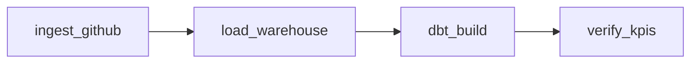

# Local Apache Airflow orchestration

## Completed local deployment

**The local orchestration milestone is validated.** Airflow 3.3.2 runs on WSL2
Ubuntu 24.04 with Python 3.12.3. The real `engineering_data_pipeline` DAG completed
all four stages successfully on 2026-11-23. Its run ID is
`manual__2026-11-23T09:21:18.097597+00:00`; the reported duration was **31.620
seconds**. The final task confirmed KPI parity for both repositories with no
discrepancies. Detailed evidence and independently rerun tests appear below.

The initial preflight on 2026-10-31 recorded the following historical state;
WSL2 and the Linux environments were subsequently installed and configured:

| Check | Actual result |
| --- | --- |
| Git | Clean `feature/airflow-orchestration` before modifications |
| Windows | Windows 11, PowerShell 5.1, Python 3.12.9 |
| Existing Windows `.venv` | DuckDB 1.5.6, dbt Core 1.12.6, dbt-duckdb 1.11.1; preserved |
| `wsl --status` and `wsl --list --verbose` | WSL was not installed at the initial preflight; now WSL2 Ubuntu 24.04 is running |
| `docker version` / `docker compose version` | Docker command unavailable |
| Docker Desktop | Executable not found at the standard installation location |

The initial preparation did not install system software or Airflow. The selected
WSL2 deployment is now operational; Docker/Compose are not needed. The official
Windows choices are WSL2 or Linux
containers; native Windows Airflow and Git Bash are not supported runtimes.

## Selected setup and dependency boundaries

The validated setup uses **WSL2 + Ubuntu 24.04 + Python 3.12 + `airflow standalone`**, with SQLite for
Airflow's own local metadata. This starts the API/UI, scheduler, DAG processor,
and triggerer on one machine with LocalExecutor. There is no Celery worker,
Redis, PostgreSQL service, Docker stack, paid API, or account requirement.
SQLite is for development only. It does not replace either engineering DuckDB.

At preflight, the official stable documentation and PyPI both reported Airflow
**3.3.2**, with Task SDK **1.3.2**. Airflow supports Python 3.12. The release's
official `constraints-3.12.txt` URL returned HTTP 200; its SHA-256 was
`821effd0f491975682f2774fca3427d7bc2f59ca6de68dcb413ad2c8f890e58c`.
Those constraints pin, for example, Pydantic 2.13.5 and requests 2.34.2. They
constrain dependencies; they do not install every optional provider listed.

Two separate **Linux** virtual environments avoid forcing dbt and Airflow to
share dependency versions:

| Environment | Contents | Used by |
| --- | --- | --- |
| `~/.venvs/aedp-airflow` | Airflow 3.3.2 with its official Python 3.12 constraints | Scheduler, UI, SDK task wrappers |
| `~/.venvs/aedp-pipeline` | Existing pinned dbt/DuckDB versions plus requests 2.34.2 | All four pipeline commands |
| Existing project `.venv` on Windows | Existing dependencies, unchanged | Existing Windows commands and offline tests |

`orchestration/requirements-airflow.txt` contains the Airflow release and
constraint URL. `requirements-pipeline.txt` includes the existing
`requirements-dbt.txt` rather than copying its pins. No optional Airflow extras
are requested. In addition to the original compatibility/constraints review, the
installed Linux environments have now executed the real DAG successfully.
Finalization confirmed Airflow 3.3.2 and Task SDK 1.3.2 in the Airflow environment.
The existing Windows `.venv` continues to run the Windows test suite separately.

## One-time WSL2 setup (completed on this machine)

Keep these instructions for reproducing the environment on a fresh Windows
machine. WSL2 installation is already complete here; do not reinstall it to run
the existing deployment. In an **Administrator PowerShell** window:

```powershell
wsl --install -d Ubuntu-24.04
```

Restart Windows if requested, then finish Ubuntu's initial Linux user setup.
Check that the distribution shows version **2**:

```powershell
wsl --status
wsl --list --verbose
wsl -d Ubuntu-24.04
```

If it shows WSL1, follow Microsoft's WSL2 conversion instructions before running
Airflow. Virtualization may need enabling in firmware or Windows features; the
installer reports what the machine needs. No Docker Desktop installation is
required. See [Microsoft's WSL installation guide](https://learn.microsoft.com/en-us/windows/wsl/install).

## Linux setup and path validation

Run the following in the **Ubuntu terminal**, not PowerShell or Git Bash. These
commands describe the one-time Linux prerequisites and environment installation.
The existing deployment already has these environments; use the activation and
validation commands rather than recreating them:

```bash
sudo apt update
sudo apt install python3.12 python3.12-venv git

# Convert the existing checkout's Windows location to its real WSL path.
REPO="$(wslpath -u 'C:\Users\Negin\Documents\ai-data-quality-platform')"
cd -- "$REPO"
pwd -P
findmnt -T .
test -f src/engineering_intelligence/ingest_github.py
test -f dbt/profiles.yml
python3.12 --version

python3.12 -m venv "$HOME/.venvs/aedp-airflow"
python3.12 -m venv "$HOME/.venvs/aedp-pipeline"

"$HOME/.venvs/aedp-airflow/bin/python" -m pip install -r orchestration/requirements-airflow.txt
"$HOME/.venvs/aedp-airflow/bin/python" -m pip check
"$HOME/.venvs/aedp-pipeline/bin/python" -m pip install -r orchestration/requirements-pipeline.txt
"$HOME/.venvs/aedp-pipeline/bin/python" -m pip check

source orchestration/environment.sh
airflow version
```

Check each command succeeds before continuing. The path above is this machine's
current checkout; adjust it if the repository moves. `wslpath` must produce an
existing absolute Linux path such as `/mnt/c/Users/...`. This uses the **same**
project files and databases without copying or replacing them. Linux executables
live in the Linux home directory. Never point tasks at `.venv/Scripts/python.exe`.
The environment script computes the repository root from its own location, so
paths with spaces work. `.gitattributes` keeps this shell script's line endings LF.

`environment.sh` selects one local task, one DAG run, one parser, and one API
worker. It binds the API to `127.0.0.1:8080`, retains password authentication, and
disables dbt telemetry. Airflow state/logs/generated credentials live outside the
checkout in `~/.local/share/aedp-airflow`.

Before starting Airflow, stop Windows commands that access these databases and
validate the real Linux runtime and lock on the actual project filesystem:

```bash
"$HOME/.venvs/aedp-airflow/bin/python" - <<'PY'
from orchestration.pipeline_runtime import get_runtime, pipeline_lock
runtime = get_runtime()
print('Project:', runtime.project)
print('Pipeline Python:', runtime.python)
with pipeline_lock(runtime.project):
    print('Actual project filesystem accepts the pipeline lock.')
PY

"$HOME/.venvs/aedp-pipeline/bin/dbt" debug \
  --project-dir "$ENGINEERING_PROJECT_ROOT/dbt" \
  --profiles-dir "$ENGINEERING_PROJECT_ROOT/dbt"

# Includes the actual Airflow DagBag import, which is skipped on Windows.
"$HOME/.venvs/aedp-airflow/bin/python" -m unittest discover \
  -s tests -p test_airflow_orchestration.py -v
```

The runner rejects native Windows execution, Windows/relative path strings,
missing project files, a different checkout, and a missing Linux pipeline venv
or dbt executable. It preserves the venv's `bin/python` symlink path instead of
resolving it to a system interpreter. The successful real run exercised this
runner and its per-task file lock against the existing project under
`/mnt/c/Users/Negin/Documents/ai-data-quality-platform`. This validates that local
path/lock usage, not independent Windows/Linux contention or every filesystem.
On another mount, repeat the checks; unsupported locking fails closed.

## DAG and command architecture



| Task | Existing command executed in the Linux pipeline venv | Process timeout |
| --- | --- | --- |
| `ingest_github` | `python -m src.engineering_intelligence.ingest_github` | 5 minutes |
| `load_warehouse` | `python -m src.engineering_intelligence.load_github` | 3 minutes |
| `dbt_build` | `dbt build --project-dir <root>/dbt --profiles-dir <root>/dbt` | 10 minutes |
| `verify_kpis` | `python -m src.engineering_intelligence.verify_dbt_kpis` | 2 minutes |

The DAG uses Airflow 3's public `airflow.sdk.DAG` and `task`. Functions call the
thin `pipeline_runtime.py` runner. It constructs fixed argument lists, sets the
working directory and Linux environment, streams child output into task logs,
and raises on nonzero exit or timeout. No shell interprets arguments. The DAG
does not implement ingestion, SQL, validation, or KPI formulas again. Large data
and command results are not returned through XCom.

Airflow controls **when** each task runs and records its state; the scripts still
control **what** the stage does. All downstream tasks require `all_success`.
An ingestion API/rate-limit error prevents loading, even if partial raw snapshots
were saved. A loader quality failure prevents dbt, even if some transactions
already committed. A dbt model/data-test failure prevents parity verification.
A parity discrepancy fails the final task and therefore the run. There is no
success-only cleanup task that could hide these errors.

Each Airflow task budget is 30 seconds longer than its process budget to allow
termination/cleanup; the whole DAG has a 30-minute timeout. On timeout or task
termination, the runner terminates the subprocess group, escalates to kill after
a grace period, and re-raises the failure. Retries are **zero** deliberately:
deterministic validation failures need investigation, and blindly retrying a
rate-limited or partially completed extraction can add confusing snapshots.
The configured five-minute retry delay only applies if retries are deliberately
enabled later; it does not create a retry now.

## Concurrency and DuckDB boundaries

`max_active_runs=1`, `max_active_tasks=1`, serial task dependencies, and local
executor parallelism 1 prevent overlapping scheduled/manual runs of this DAG in
the selected Airflow instance. A nonblocking Linux `flock` on
`data/processed/.airflow_pipeline.lock` also serializes commands using this runner,
including reads during dbt/parity. A busy lock fails the task before launching a
command. The child inherits the lock descriptor, retaining protection if its
parent is abruptly killed. The empty lock file is retained; its presence does
not mean a lock is held. Never delete it to bypass contention.

This is a cooperative lock per task, not a distributed run-wide lease. Unchanged
standalone Windows scripts do not participate in it. Do not run another Airflow
instance, `airflow dags test`, Windows loaders, dbt builds, or other database
consumers concurrently with the real DAG. In particular, do not rely on POSIX
locks coordinating independent Windows processes through `/mnt/c`. Stop those
commands first. If a task is forcibly killed, inspect its child processes before
retrying; a still-running child can legitimately keep the lock.

The existing dbt profile still attaches `engineering.duckdb` read-only and writes
to `engineering_dbt.duckdb`. Source timestamps, supplying run IDs, page counts,
errors, quality warnings, and pagination limits are preserved. Ingestion still
defaults to the existing two repositories and three pages each; no values are
duplicated in orchestration. The loader still selects the latest metadata-valid
snapshot per repository. DAG run IDs/logical dates do not change extraction
timestamps or turn bounded snapshots into historical backfills.

Open age remains age at each PR's extraction, merge duration remains creation to
merge, and the rate uses the observed cohort. A green Airflow run means these
commands and their checks succeeded; it does not establish complete GitHub
history, freshness forever, business causality, or developer productivity.

## Start, UI, and manual trigger

In Ubuntu terminal 1, from the project root:

```bash
source orchestration/environment.sh
airflow standalone
```

Leave it running. Open **http://localhost:8080** in the Windows browser. Use the
generated local credentials from startup output. If the password is not printed,
inspect the local file `$AIRFLOW_HOME/simple_auth_manager_passwords.json.generated`.
Do not paste it into source files or commits. No password is hardcoded here.

In Ubuntu terminal 2, enter the same checkout and source the environment again:

```bash
source orchestration/environment.sh
airflow dags list-import-errors
airflow dags list

# First creation is paused. Unpause does not schedule work while schedule=None.
airflow dags unpause engineering_data_pipeline
RUN_ID="manual__smoke_$(date -u +%Y%m%dT%H%M%SZ)"
airflow dags trigger --run-id "$RUN_ID" engineering_data_pipeline

airflow dags list-runs engineering_data_pipeline
airflow tasks states-for-dag-run engineering_data_pipeline "$RUN_ID"
```

A trigger only queues a run; it is not proof of success. In the UI, open this run's
Graph/Grid and each of its four task logs. Confirm the commands, their real
output, nonzero-error absence, and eventual `success` states. The dbt log must
show model and data-test results, and parity must show `PASS` and zero differences.
Record the run ID, all task states, relevant log lines, and report filenames in
the validation section below only after observing them. Do not mark tasks
successful manually to make a smoke test pass.

Task logs are under `$AIRFLOW_HOME/logs/` (normally organized by DAG, run, task,
and attempt). dbt artifacts/logs remain in ignored `dbt/target/` and `dbt/logs/`;
parity JSON remains in ignored `data/reports/`. Raw snapshots and databases remain
in their existing locations. Inspect failed logs and retained data before
clearing a failed task and its downstream tasks in the UI. Keep upstream evidence
intact; rerunning ingestion intentionally creates new snapshots.

## Recurring execution, resource use, and cleanup

The checked-in DAG has `schedule=None`, `catchup=False`, and starts paused. To
enable recurrence after a successful real run, deliberately change `schedule`
to, for example, `"0 6 * * *"` (06:00 UTC daily), let Airflow reparse it, and
unpause. `catchup=False` avoids scheduling all past intervals. It does not block
explicit manual triggers or create historic GitHub observations. Keep concurrency
limits at one. Return to `schedule=None` and pause to disable future automatic
execution; pausing does not kill an already-running task.

Airflow's published minimum memory recommendation is 4 GB. Budget roughly 4–6 GB
for this small WSL development runtime plus temporary dbt/Python overhead; this
is an estimate, **not a measurement on this machine**. With 16 GB total, avoid
running a large local Ollama model at the same time. No GPU is needed. Keeping
Airflow's SQLite database and virtual environments in Linux home avoids placing
their many small files on the slower Windows mount. The shared warehouse remains
in the existing project; `/mnt/c` performance and locking must be checked locally.

To stop safely, pause the DAG, wait for active tasks to finish, then press Ctrl+C
in the `airflow standalone` terminal and confirm its components stop. Keep
`AIRFLOW_HOME` and project data to preserve run history and logs. Optional removal
of the two dedicated Linux venvs or Airflow home should happen only after all
processes stop and after saving any desired logs; no deletion command is supplied
or executed here. Do not run `airflow db reset` or remove project data as cleanup.

This is a learning/development installation: no production metadata service,
distributed workers, high availability, historical snapshot pinning per run,
global cross-OS locking, alerts, or log-retention policy is implemented. A failed
run can leave valid partial snapshots, per-repository warehouse commits, or
partially refreshed marts. The dependency chain prevents downstream consumption
as a successful pipeline; it does not roll back the whole project.

## Automated checks and actual validation

On Windows, use the existing environment with no Airflow installation:

```powershell
.\.venv\Scripts\python.exe -m unittest discover -s tests -p test_airflow_orchestration.py -v
.\.venv\Scripts\python.exe -m unittest discover -s tests -v
```

The orchestration tests import the real DAG declaration using a small mocked SDK
and inspect task configurations, exact dependencies, no work at parse time, and
failure propagation. Mocked subprocess tests check command arguments, pipeline
venv/environment, lock boundaries, streamed logging, nonzero exits, timeouts, and
process cleanup. Path/lock tests are deterministic and make no API requests.
These checks **do not execute an Airflow scheduler**. The actual `DagBag` import
test skips explicitly until run from the separate Linux Airflow environment.
The full suite also runs the existing real dbt integration checks against
temporary, controlled DuckDB fixtures.

### Historical preparation baseline: 2026-10-31

| Check | Result |
| --- | --- |
| New orchestration tests | 18 discovered: 17 passed, 1 explicitly skipped native Airflow import |
| Complete suite | 201 discovered: 200 passed, 1 skipped, 0 failures/errors in 38.164 seconds |
| Existing dbt integration tests | Passed using real dbt builds/tests on isolated temporary DuckDB fixtures |
| Shell syntax | `bash --noprofile --norc -n orchestration/environment.sh` passed using installed Git Bash; this checks syntax only |
| Windows dependency health | `pip check`: no broken requirements; Airflow remains uninstalled in this environment |
| Source preservation | SHA-256 checks matched all 56 checked existing data, source, archived, analytics, evaluation, and dbt source files |
| Native Linux Airflow import, WSL mount/lock, UI, DAG execution, task logs | Not performed at that time; superseded by the 2026-11-23 validation below |

That historical independent read-only KPI verification matched all 26 legacy
columns for both repositories with zero discrepancies. At that time, the source
warehouse contained 90 observations per repository; both stored runs fetched
three pages and were pagination-incomplete. It was a Windows command check,
**not an Airflow task execution**.

The preserved, ignored report
`data/reports/airflow_validation_20261031T192522193959Z.json` records that original
preflight, missing runtime, and preparation results. It is historical evidence,
not the status of the completed Linux deployment.
The pre-change hashes are retained in
`data/reports/airflow_preservation_before_20261031.json`. No original report was
overwritten. That initial preparation did not call ingestion or load the warehouse;
the later successful DAG intentionally created snapshots and updated the source
and transformed warehouses using the existing scripts.

### Real Linux end-to-end run: 2026-11-23

The supplied evidence was corroborated during finalization by opening Airflow's
SQLite metadata with `mode=ro`, inspecting selected success lines in the existing
task logs, and reading the saved parity JSON. No new DAG run was triggered during
finalization.

| Evidence | Verified value |
| --- | --- |
| Runtime | WSL2 Ubuntu 24.04, Python 3.12.3, Airflow 3.3.2, Task SDK 1.3.2 |
| DAG | `engineering_data_pipeline` |
| Run ID | `manual__2026-11-23T09:21:18.097597+00:00` |
| DAG status | `success` |
| Reported duration | 31.620 seconds |
| Metadata start/end (UTC) | `2026-11-23T09:21:19.645025Z` / `2026-11-23T09:21:51.265819Z` |
| Final task log | `KPI parity: PASS; 2 repositories, 26 columns, 0 discrepancies.` |
| Parity report | `data/reports/dbt_kpi_parity_20261123T092150851572Z.json` |

The metadata timestamps give a precise elapsed interval of 31.620794 seconds;
31.620 seconds is the supplied reported duration. All four tasks ran in order:

| Task | Outcome | Supporting log evidence |
| --- | --- | --- |
| `ingest_github` | `success` | `Completed ingest_github successfully.` |
| `load_warehouse` | `success` | `Completed load_warehouse successfully.` |
| `dbt_build` | `success` | `PASS=57 WARN=0 ERROR=0 SKIP=0`: 5 models and 52 data tests |
| `verify_kpis` | `success` | Parity PASS for 2 repositories and 26 columns; zero discrepancies |

The parity report names Linux source and transformed database paths, sets
`passed: true`, and contains an empty `differences` list. Its source hashes match
before/after verification:
`b802f9fd98f298066536ee0eb4896768c1ce0f584ab4bdea936c0f9f34165f59`.
This proves that the verifier left its source unchanged during that stage; it
does not imply that ingestion/loading left the warehouse unchanged across the
whole DAG. The report labels the data an observed, potentially incomplete cohort.

### Airflow 3.3.2 test compatibility

The native test corrections remain limited to the supported API and enum value:

```python
from airflow.dag_processing.dagbag import DagBag
bag = DagBag(dag_folder=str(DAG_FILE.parent))
# After all existing DAG/dependency assertions:
self.assertTrue(all(task.trigger_rule.value == 'all_success' for task in dag.tasks))
```

Airflow 3.3.2 removed the `include_examples` constructor argument. All four actual
task rules were inspected: each is
`airflow.sdk.api.datamodels._generated.TriggerRule.ALL_SUCCESS`, with underlying
value `'all_success'`. `str(rule)` produces `'TriggerRule.ALL_SUCCESS'`, so the
old stringification assertion was incorrect. No trigger rule, dependency,
concurrency setting, security check, or other assertion was relaxed.

### Finalization checks: 2026-11-23

| Environment/check | Actual result |
| --- | --- |
| Linux Airflow venv: focused orchestration suite | **18/18 passed**, zero skips/failures, 2.514 seconds |
| Windows `.venv`: complete suite | **201 discovered: 200 passed, 1 expected Linux-only skip**, zero failures/errors, 55.153 seconds |
| Real Airflow coverage | Linux focused suite includes actual `DagBag` loading and trigger-rule/dependency assertions |
| Mocked coverage | The other orchestration checks use mocked SDK/subprocess boundaries; they are not additional live DAG runs |
| Existing dbt coverage | Windows full suite includes real dbt integration checks on controlled temporary warehouses |
| Git hygiene | `git status` reviewed; `git diff --check` passed; tracked and unignored reviewable files contain no generated databases, logs, auth files, or matches for the credential patterns checked |

Generated snapshots, DuckDB databases, dbt artifacts, reports, and Airflow
authentication/state files remain outside Git. Airflow home remains
`/home/negin/.local/share/aedp-airflow`; generated passwords and auth keys are not
copied into this guide. The October reports and November parity report are
preserved. No ingestion, warehouse, dbt, Agent, or orchestration business logic
was changed during finalization, and no commit or push was performed.

The local manual-run milestone has no remaining environment blocker. Its limits
still apply: one successful run is not a load/recovery/soak test, a distributed
locking proof, or a production deployment. A recurring schedule remains disabled.
There is no whole-pipeline rollback or run-pinned immutable input selection, and
the GitHub data remains a potentially incomplete observed cohort. Repeatability
of formulas and successful parity do not prove complete history or business
causality. Preserve the existing success-only dependencies and concurrency limits.

## Official references checked

- [Airflow 3.3.2 prerequisites and supported OS/Python](https://airflow.apache.org/docs/apache-airflow/3.3.2/installation/prerequisites.html)
- [Airflow standalone quick start](https://airflow.apache.org/docs/apache-airflow/3.3.2/start.html)
- [Official Python 3.12 constraints for 3.3.2](https://raw.githubusercontent.com/apache/airflow/constraints-3.3.2/constraints-3.12.txt)
- [Airflow Task SDK public API](https://airflow.apache.org/docs/task-sdk/stable/api.html)
- [Airflow 3.3.2 CLI reference](https://airflow.apache.org/docs/apache-airflow/3.3.2/cli-and-env-variables-ref.html)
- [LocalExecutor](https://airflow.apache.org/docs/apache-airflow/3.3.2/core-concepts/executor/index.html)
- [Configuration reference](https://airflow.apache.org/docs/apache-airflow/3.3.2/configurations-ref.html)
