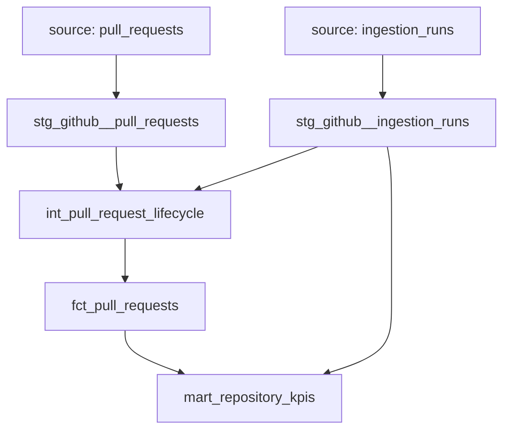

# Local dbt transformation layer

dbt Core turns checked-in SQL models into database views and tables, orders their
dependencies, runs data tests, and generates documentation. DuckDB still executes
the SQL. Python ingestion still obtains and validates source observations. No dbt
Cloud account, API key, external dbt package, or DuckDB extension is used.

## Environment and root PowerShell commands

Checked Python: 3.12.9. Direct dependencies are pinned in `requirements-dbt.txt`:
dbt Core 1.12.6, dbt-duckdb 1.11.1, and the existing DuckDB 1.5.6. Resolution was
checked before installation. Existing `requests` 2.34.2 and its dependencies were
retained. dbt's required transitive packages are installed too; no framework for
orchestration or cloud access is added. These direct pins are not a complete
transitive lock file.

Run from the repository root, using the existing virtual environment:

```powershell
.\.venv\Scripts\python.exe --version
.\.venv\Scripts\python.exe -m pip install -r .\requirements-dbt.txt
.\.venv\Scripts\python.exe -m pip check

$env:ENGINEERING_PROJECT_ROOT = (Get-Location).Path
$env:DBT_SEND_ANONYMOUS_USAGE_STATS = "false"

.\.venv\Scripts\dbt.exe debug --project-dir .\dbt --profiles-dir .\dbt
.\.venv\Scripts\dbt.exe run --project-dir .\dbt --profiles-dir .\dbt
.\.venv\Scripts\dbt.exe test --project-dir .\dbt --profiles-dir .\dbt
.\.venv\Scripts\python.exe -m src.engineering_intelligence.verify_dbt_kpis
.\.venv\Scripts\python.exe -m unittest discover -s tests -v
```

The warehouse and its parent directory must already exist. Do not run the loader
just to test dbt against an existing warehouse. `ENGINEERING_PROJECT_ROOT` is an
absolute directory, so spaces in Windows paths work and dbt does not depend on
its internal working directory. Set it again in a new terminal. `--profiles-dir`
selects the checked-in, credential-free profile instead of a global user profile.
There is no need to activate `.venv` or run `dbt init` or `dbt deps`.

`dbt run` materializes all five models. `dbt test` checks their data and the
sources; it does not create the models first. For an ordered run that also gates
downstream nodes on upstream tests, use:

```powershell
.\.venv\Scripts\dbt.exe build --project-dir .\dbt --profiles-dir .\dbt
.\.venv\Scripts\dbt.exe docs generate --project-dir .\dbt --profiles-dir .\dbt
```

The second command generates the local catalog, manifest, and documentation HTML
under ignored `dbt/target/`. It does not publish anything. Never consume a failed
build as validated output; individual models commit separately, so an unsuccessful
run can leave a mixture of old and new tables.

## Read-only source and separate output

`dbt/profiles.yml` connects to `data/processed/engineering_dbt.duckdb` for writes.
It attaches `data/processed/engineering.duckdb` as `engineering_source` with
`read_only: true`. The source definition addresses
`engineering_source.main.pull_requests` and `.ingestion_runs`.

The actual connection's `duckdb_databases().readonly` flag is tested. The parity
checker also reads both files read-only and records the source file's SHA-256
before/after verification. Existing agents and reports continue using their
existing warehouse and SQL; this milestone does not switch their data source.

No local secrets or absolute machine paths are checked in. The profile itself is
version-controlled because it is reproducible project configuration. Database
files, `target/`, logs, packages, and optional `profiles.local.yml` are ignored.
Models, YAML documentation, SQL tests, and the profile remain visible to Git.

Run the warehouse loader and dbt sequentially. DuckDB file locks do not permit
concurrent processes to write the source while dbt attaches it read-only. dbt uses
one thread. Separate dbt model statements are not a project-wide snapshot
transaction; orchestration must keep the source unchanged throughout a build and
parity check. A changed warehouse requires another dbt build before comparison.

## DAG, grains, and materializations

`source()` identifies an external input and `ref()` identifies another dbt model.
Both compile to quoted database relations and register lineage in the dependency
graph (DAG: directed acyclic graph). A file's folder does not define execution
order; these dependencies do.



| Model | Grain: what one row represents | Materialization |
| --- | --- | --- |
| `stg_github__pull_requests` | Newest stored observation of one repository/PR | View in `analytics_staging` |
| `stg_github__ingestion_runs` | One loaded snapshot/run | View in `analytics_staging` |
| `int_pull_request_lifecycle` | One PR observation plus supplying-run context and durations | View in `analytics_intermediate` |
| `fct_pull_requests` | One PR observation, durations, provenance, link, and cohort label | Table in `analytics_marts` |
| `mart_repository_kpis` | One repository, including repositories with a run and zero PRs | Table in `analytics_marts` |

dbt's default schema naming joins the profile schema (`analytics`) and folder
schema. Thus the KPI relation is
`engineering_dbt.analytics_marts.mart_repository_kpis`. Views keep preparation
steps small and inspectable. Tables give consumers stored results that can be
queried without reattaching the source. The views still require the source
attachment when queried outside dbt. Full table rebuilds are appropriate for this
small warehouse and are repeatable without accumulating duplicates. No incremental
state or historical event table is introduced.

Staging preserves source types without filtering or repairing records. All typed
timestamps are `TIMESTAMPTZ` and the session timezone is UTC. `_utc` names document
that contract. `observed_state` means state at `observed_at_utc`, not state today.
The simple `pr_key = repository || '#' || pr_number` gives one identifier across
repositories, while the natural composite key remains `(repository, pr_number)`.
GitHub repository names cannot contain `#`. YAML describes columns and meanings.
KPI extraction range fields retain the existing ISO UTC text format for parity.

The lifecycle model left-joins a PR to its supplying run by **both** repository
and run ID. Missing provenance is retained so tests can expose it. The KPI mart
aggregates PRs before joining the latest run, preventing counts from multiplying
when a repository has several runs. The latest run is selected by extraction time
descending and run ID ascending for ties.

## Definitions preserved

- Merge duration: `(merge instant - creation instant) / 3600`, in elapsed hours.
- Open age: `(that PR's extraction instant - creation instant) / 86400`, in elapsed
  days, for observed open PRs. It never calls `now()` or uses the newest repository
  run in place of a PR's observation time. Strictly older than seven means `> 7`.
- Merge rate: merged PR count / total observed PR count, as a fraction. It is
  `NULL` for no observed PRs. An unmerged but nonempty cohort has rate zero.
- Means and medians exclude `NULL` durations. For an even number of samples,
  DuckDB's median averages the two middle values. Sample counts expose coverage.
- `CASE WHEN` conditions choose rows contributing to each count or duration.
  `GROUP BY repository` collects observations per repository. `SUM`, `AVG`, and
  `MEDIAN` then reduce each group to statistics.
- Zero counts for an empty cohort are meaningful; unavailable rates, ages, and
  durations remain `NULL`. No missing metric is silently replaced with zero.
- Contributing-run completeness is false if any observation came from an
  incomplete run, otherwise unknown if any provenance/completeness is missing,
  otherwise true. With no observations it is unknown. Latest-run completeness is
  reported separately.

Every mart is labeled **observed, potentially incomplete PR cohort**. Old PRs
retained after bounded extractions can have different observation times. Three
fetched pages do not represent complete GitHub history. Exhausted pagination
still does not provide every historical event. Starting URLs containing `page=1`
do not describe pages fetched. This layer does not calculate source freshness or
infer subsequent GitHub events, causes, review activity, or developer productivity.

## Data tests and controlled integration checks

dbt generic tests cover source run uniqueness, required identifiers/timestamps,
unique analytical PR keys, required title/author/state, accepted states, and
run-ID relationships. Tests document expectations; they do not add physical
primary/foreign-key constraints to the analytical tables.

Custom SQL tests return offending rows (zero rows means pass):

- `assert_pr_composite_key`: duplicate `(repository, pr_number)` facts.
- `assert_pr_lifecycle`: nonpositive numbers, negative/out-of-order lifecycle
  intervals, open PRs with closure/merge times, closed PRs without closure time,
  and open observations predating creation.
- `assert_pr_observation_relationship`: missing supplying runs, repository/run
  mismatches, or a PR extraction instant inconsistent with its run.
- `assert_ingestion_metadata`: negative/count-mismatch metadata, invalid finish
  ordering, or completeness contradicting stop/error status. Stored unknowns stay
  unknown; these tests do not manufacture metadata.
- `assert_source_attachment_read_only`: the actual source attachment must exist
  and be read-only.

`tests/test_dbt_transformations.py` creates isolated temporary warehouses and
runs real dbt commands. Controlled data checks known counts, rates, odd/even
medians, fractional hours, exactly seven days, timezone offsets, mixed old/new
observations, unknown and incomplete runs, an empty repository, a completely empty
warehouse, missing merge durations, repeated builds, and source-file preservation.
Negative tests deliberately corrupt disposable transformed relations and require
the dbt lifecycle and relationship tests to fail. Another corrupts a disposable
KPI to prove the parity checker detects discrepancies. No source data in the
project is changed. Without dbt installed these integration tests explicitly skip;
install the requirements to run the full checks.

## Independent parity verification

`verify_dbt_kpis.py` executes the existing `sql/analytics/pr_observations.sql` and
`repository_kpis.sql` against the source without editing them, then reads the dbt
KPI table. It compares every legacy output column, including counts, NULLs, dates,
run lists, errors, and completeness. Floating values use relative tolerance
`1e-12` and absolute tolerance `1e-9`; other values compare exactly. Additional
dbt cohort labels do not change the legacy schema. Missing/extra repositories,
duplicate repository rows, and missing legacy columns fail verification.

A timestamped JSON report under ignored `data/reports/dbt_kpi_parity_*.json`
records differences and source hashes. Any discrepancy produces exit code 1 and
must be investigated instead of changing established formulas to hide it. This
proves consistency with existing calculations on the tested data, not correctness
of GitHub's source records, complete history, or business causality.

## Future Airflow orchestration

A later DAG can order ingestion -> warehouse load -> `dbt build` -> parity check
-> approved consumers. Each task must check the preceding command's exit code,
set the project-root environment variable, keep the source stable, and retain dbt
artifacts for diagnosis. Airflow schedules and retries tasks; dbt owns SQL model
dependencies and data tests. Airflow, dbt-based Agent integration, cloud services,
and deployment remain unimplemented.

## Validation results

Local validation on 2026-10-31, using the existing warehouse and virtual environment:

| Check | Actual result |
| --- | --- |
| `pip check` | No broken requirements |
| `dbt debug` | Configuration, Git, and database connection checks passed |
| `dbt run` | 5/5 models succeeded: 3 views, 2 tables |
| `dbt test` | 52/52 data tests passed, no warnings or skips |
| Final `dbt build` | 57/57 nodes passed: 5 models + 52 tests |
| `dbt docs generate` | Local catalog/documentation generated successfully |
| Real KPI parity | 2 repositories, all 26 legacy columns matched, 0 discrepancies |
| Full `unittest` suite | 183 passed in 91.824 seconds, no skips or failures; includes 11 new dbt/parity checks |

The real fact table contains 180 observations: 90 per repository. The repository
mart contains two rows. Both latest runs have `pagination_complete = false` and
three stored pages fetched; none of these results establishes complete history.
Final validation found no numerical or metadata discrepancies requiring a change
to the established formulas.

The initial fixture build exposed a trailing semicolon incompatible with dbt's
table wrapper; it was removed from the new model only. A negative-test cleanup
also initially omitted the read-only attachment needed to recreate a staging
view; that temporary-fixture cleanup was corrected. The final complete suite and
real build passed after those corrections. Lifecycle and wrong-repository
provenance negative controls fail dbt intentionally and are counted as successful
automated checks only when the expected rejection is confirmed.

Source preservation was checked against a pre-installation SHA-256 manifest:
all 21 checked existing warehouse/raw/report files were unchanged, including the
original evaluation reports. Source warehouse SHA-256:
`08a3517ba040e3d4857bc86391f6ededde46f136be4db9620e5ab2405173a652`.
Ignored audit files are `data/reports/dbt_preservation_before_20261031.json` and
`dbt_preservation_check_*.json`; final parity evidence is
`data/reports/dbt_kpi_parity_20261031T120327453146Z.json`.

No required milestone work remains unfinished. Automatic scheduling, incremental
models, historical PR events, and connecting consumers to the new marts remain
future work. Existing analytical SQL and Agent/evaluation behavior are preserved.

References: [dbt Python compatibility](https://docs.getdbt.com/faqs/Core/install-python-compatibility),
[dbt-duckdb configuration and read-only attachments](https://github.com/duckdb/dbt-duckdb#attaching-additional-databases),
[DuckDB ATTACH documentation](https://duckdb.org/docs/current/sql/statements/attach).
